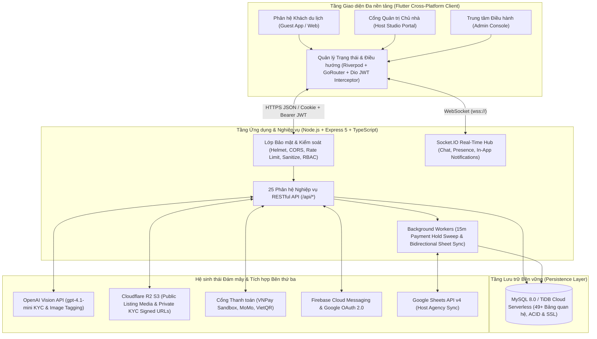
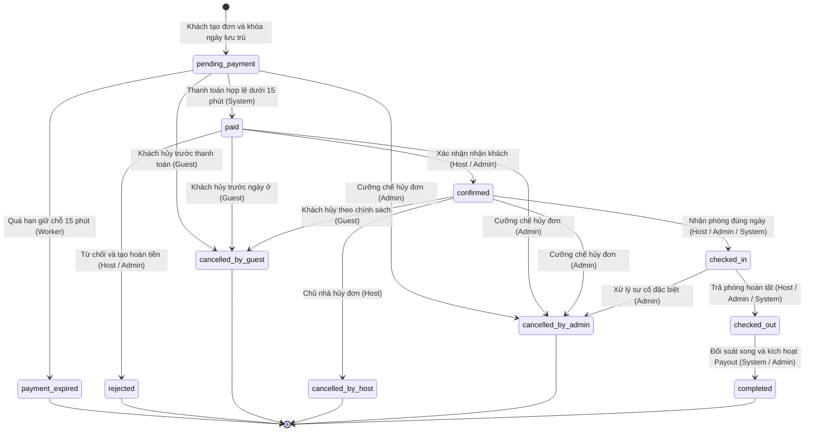
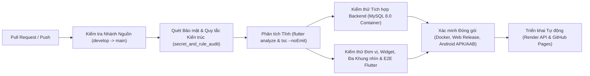

<div align="center">

# THE PALM VILLA

### Hệ thống Đặt phòng và Quản lý Biệt thự Nghỉ dưỡng Đa nền tảng
*(Multi-Platform Vacation Villa Booking & Property Management System)*

[](https://github.com/DangKimAn/Software-Project-Management/actions/workflows/flutter_ci.yml)
[](https://github.com/DangKimAn/Software-Project-Management/actions/workflows/backend-ci.yml)
[](https://github.com/DangKimAn/Software-Project-Management/actions/workflows/deploy-flutter-web.yml)
[](https://github.com/DangKimAn/Software-Project-Management/actions/workflows/deploy-backend.yml)

[](https://flutter.dev)
[](https://dart.dev)
[](https://nodejs.org)
[](https://expressjs.com)
[](https://www.typescriptlang.org)
[](https://www.pingcap.com/tidb-cloud-serverless/)

**Đồ án Học phần: Quản lý Dự án Phần mềm (*Software Project Management*)**  
**Đơn vị đào tạo:** Khoa Công nghệ Thông tin 2 — Học viện Công nghệ Bưu chính Viễn thông Cơ sở tại TP. Hồ Chí Minh (PTIT HCM)

[Tóm tắt khoa học](#1-tóm-tắt-khoa-học--abstract) •
[Kiến trúc hệ thống](#3-kiến-trúc-tổng-thể-hệ-thống) •
[Mô hình nghiệp vụ](#4-mô-hình-hóa-nghiệp-vụ-trọng-tâm) •
[Cài đặt & Thực nghiệm](#7-hướng-dẫn-cài-đặt-và-tái-lập-môi-trường-thực-nghiệm) •
[Kiểm thử & CI/CD](#8-đảm-bảo-chất-lượng-kiểm-thử-và-cicd) •
[Tài liệu phân hệ](#10-tài-liệu-chuyên-sâu-theo-phân-hệ)

</div>

---

## Mục lục

1. [Tóm tắt khoa học / Abstract](#1-tóm-tắt-khoa-học--abstract)
2. [Đặt vấn đề và Mục tiêu nghiên cứu](#2-đặt-vấn-đề-và-mục-tiêu-nghiên-cứu)
3. [Kiến trúc tổng thể hệ thống](#3-kiến-trúc-tổng-thể-hệ-thống)
4. [Mô hình hóa nghiệp vụ trọng tâm](#4-mô-hình-hóa-nghiệp-vụ-trọng-tâm)
   - [4.1. Máy trạng thái hữu hạn đơn đặt phòng (Booking FSM)](#41-máy-trạng-thái-hữu-hạn-đơn-đặt-phòng-booking-fsm)
   - [4.2. Phân quyền RBAC và Ma trận phân hệ chức năng](#42-phân-quyền-rbac-và-ma-trận-phân-hệ-chức-năng)
5. [Đặc tả công nghệ và Thư viện kỹ thuật](#5-đặc-tả-công-nghệ-và-thư-viện-kỹ-thuật)
6. [Cấu trúc kho lưu trữ (Monorepo Structure)](#6-cấu-trúc-kho-lưu-trữ-monorepo-structure)
7. [Hướng dẫn cài đặt và Tái lập môi trường thực nghiệm](#7-hướng-dẫn-cài-đặt-và-tái-lập-môi-trường-thực-nghiệm)
   - [7.1. Yêu cầu tiên quyết (Prerequisites)](#71-yêu-cầu-tiên-quyết-prerequisites)
   - [7.2. Triển khai nhanh bằng Docker Compose](#72-triển-khai-nhanh-bằng-docker-compose)
   - [7.3. Khởi chạy thủ công phục vụ phát triển (Local Development)](#73-khởi-chạy-thủ-công-phục-vụ-phát-triển-local-development)
   - [7.4. Đặc tả biến môi trường trọng yếu](#74-đặc-tả-biến-môi-trường-trọng-yếu)
8. [Đảm bảo chất lượng, Kiểm thử và CI/CD](#8-đảm-bảo-chất-lượng-kiểm-thử-và-cicd)
9. [Quản trị dự án, Nhóm tác giả và Trích dẫn học thuật](#9-quản-trị-dự-án-nhóm-tác-giả-và-trích-dẫn-học-thuật)
10. [Tài liệu chuyên sâu theo phân hệ](#10-tài-liệu-chuyên-sâu-theo-phân-hệ)

---

## 1. Tóm tắt khoa học / Abstract

### Tóm tắt (Tiếng Việt)

**The Palm Villa** (tên định danh kỹ thuật trong giai đoạn khởi tạo: *Minh Thanh Villa*) là nền tảng thương mại điện tử chuyên biệt cho phân khúc cho thuê biệt thự nghỉ dưỡng nguyên căn (*whole-villa vacation rentals*) tại TP. Vũng Tàu, được xây dựng và vận hành theo chuẩn mực của học phần **Quản lý Dự án Phần mềm**. Dự án giải quyết đồng thời bốn bài toán kỹ thuật cốt lõi trong hệ thống OTA hiện đại: (1) kiểm soát tương tranh chống đặt trùng phòng (*double-booking*) bằng cơ chế khóa ngày mức giao dịch ACID (`booking_date_locks`) kết hợp tiến trình tự động thu hồi giữ chỗ quá hạn 15 phút; (2) tách biệt rạch ròi giữa vòng đời lưu trú 11 trạng thái (**Booking Finite State Machine**) với 3 luồng đối soát tài chính độc lập (Thanh toán, Hoàn tiền, Giải ngân Maker–Checker); (3) khám phá đa tiêu chí theo phân vùng địa lý – bán kính bản đồ kết hợp thị giác máy tính (**OpenAI `gpt-4.1-mini`**) phục vụ phân loại nhãn ảnh biệt thự và bóc tách định danh CCCD (KYC); và (4) đồng bộ lịch trống hai chiều tự động với **Google Sheets** phục vụ mô hình vận hành đại lý của Chủ nhà (*Host Agency Mode*). Toàn bộ kho mã nguồn được tổ chức theo mô hình Monorepo gồm ứng dụng đa nền tảng **Flutter** (15 phân hệ chức năng, 145 tệp mã nguồn Dart, hỗ trợ Android, iOS, Web và 3 ngôn ngữ `vi`/`en`/`ko`) và máy chủ **Node.js + Express 5 + TypeScript** (25 phân hệ nghiệp vụ, 52 định nghĩa mô hình dữ liệu, 22 kịch bản di trú SQL), được bảo vệ bởi quy trình kiểm duyệt chất lượng tự động **GitHub Actions CI/CD**.

### Abstract (English)

**The Palm Villa** (initially codenamed *Minh Thanh Villa*) is an end-to-end vacation villa booking and property management platform engineered under rigorous **Software Project Management** methodologies. Designed for whole-villa rentals in Vung Tau City, Vietnam, the system addresses four critical distributed-application challenges: (1) deterministic concurrency control against double-booking via transactional date-range locking (`booking_date_locks`) paired with an automated 15-minute payment-hold expiration worker; (2) strict architectural decoupling between an 11-state **Booking Finite State Machine (FSM)** and three orthogonal financial settlement tracks (*Payment*, *Refund*, and *Maker–Checker Host Payouts*); (3) multi-criteria geospatial & availability discovery paired with **AI Computer Vision** (**OpenAI `gpt-4.1-mini`**) for automated listing media tagging and Host KYC identity verification; and (4) bidirectional **Google Sheets synchronization** tailored for real-world host agency workflows. Structured as a full-stack monorepo, the codebase integrates a **Flutter** cross-platform client (15 feature modules, 145 Dart files across Android, iOS, and Web with `vi`/`en`/`ko` localization) and a **Node.js + Express 5 + TypeScript** backend (25 domain modules, 52 Sequelize models, and 22 SQL migrations), governed by multi-stage **GitHub Actions CI/CD** pipelines and automated security/static-analysis quality gates.

---

## 2. Đặt vấn đề và Mục tiêu nghiên cứu

Hoạt động kinh doanh biệt thự nghỉ dưỡng nguyên căn có đặc thù khác biệt lớn so với khách sạn tiêu chuẩn: mỗi căn biệt thự là một tài sản đơn chiếc (*inventory = 1*), giá biến thiên mạnh theo ngày trong tuần/cuối tuần/lễ Tết, khách hàng cần tra cứu chính xác theo phân khu bãi biển, bán kính tọa độ, sức chứa đoàn đông và tiện nghi thực tế, trong khi các chủ nhà truyền thống vẫn quản lý lịch đặt qua bảng tính Google Sheets rời rạc.

Hệ thống **The Palm Villa** được thiết kế để giải quyết các thách thức trên thông qua bảng ánh xạ bài toán – giải pháp kỹ thuật dưới đây:

| Mã | Bài toán thực tiễn (Domain Problem) | Giải pháp kiến trúc & Thuật toán (Engineering Solution) | Phân hệ đối chứng trong mã nguồn |
| :--: | :--- | :--- | :--- |
| **P1** | **Xung đột đặt trùng lịch (*Double-Booking Race Condition*)** khi nhiều khách cùng thanh toán một căn biệt thự trong cùng khoảng ngày `[checkIn, checkOut)`. | Giao dịch ACID kết hợp bảng khóa ngày duy nhất `booking_date_locks` và tiến trình nền `startPaymentExpirationSweep` tự động giải phóng khóa sau 15 phút nếu chưa thanh toán. | `backend/src/modules/bookings/`<br>`backend/src/services/booking-expiration.service.ts` |
| **P2** | **Nhập nhằng giữa trạng thái lưu trú và trạng thái dòng tiền** gây sai lệch kế toán khi hủy phòng, hoàn tiền hoặc giải ngân cho Host. | Thiết kế **Booking FSM 11 trạng thái** tách rời hoàn toàn khỏi `payments.status`, `refunds.status` và quy trình phê duyệt 2 cấp (*Maker–Checker*) trên `host_payout_batch`. | `backend/src/modules/bookings/booking-state-machine.ts`<br>`backend/src/modules/payouts/` |
| **P3** | **Chuẩn hóa dữ liệu tìm kiếm theo khu vực và kiểm duyệt chất lượng hình ảnh/hồ sơ Host thủ công tốn thời gian.** | Bộ lọc đa tiêu chí kết hợp gom nhóm địa danh Vũng Tàu, bán kính tọa độ bản đồ, kiểm tra lịch trống thực tế và thị giác máy tính **`gpt-4.1-mini`** tự động gắn nhãn ảnh biệt thự & trích xuất CCCD. | `backend/src/modules/listings/`<br>`backend/src/modules/ai/` |
| **P4** | **Đứt gãy dữ liệu lịch trống** giữa sàn đặt phòng trực tuyến và bảng tính quản lý nội bộ của Chủ nhà / Đại lý. | Cơ chế **Host Agency Mode**: mỗi Host được cấp phát và đồng bộ hai chiều định kỳ với Google Sheets thông qua Service Account & hàng đợi công việc bất đồng bộ. | `backend/src/modules/host-sheet-sync/`<br>`hotel-booking-flutter/lib/features/host/` |
| **P5** | **Rủi ro lộ lọt tài liệu định danh KYC (CCCD)** và token xác thực của người dùng. | Tách biệt Bucket công khai và Bucket riêng tư trên **Cloudflare R2** (chỉ cấp phát Presigned URL hiệu lực 300 giây cho Admin duyệt KYC); xoay vòng Refresh Token HttpOnly + `FlutterSecureStorage`. | `backend/src/modules/verifications/`<br>`backend/src/modules/uploads/`<br>`tools/quality/secret_and_rule_audit.dart` |

---

## 3. Kiến trúc tổng thể hệ thống

Hệ thống tuân thủ kiến trúc phân tầng **Multi-Tier Client–Server Architecture**, kết hợp giao tiếp đồng bộ qua RESTful API (`/api/*`), kênh sự kiện thời gian thực hai chiều qua **Socket.IO**, và các tiến trình nền bất đồng bộ (**Background Workers**):



### Nguyên lý kiến trúc cốt lõi

- **Frontend (`hotel-booking-flutter/`):** Tổ chức theo mô hình **Feature-first + MVVM + Repository Pattern**. Dữ liệu mạng từ `Dio` được ánh xạ qua lớp DTO/Model bất biến (`freezed`, `json_serializable`), cung cấp lên tầng giao diện thông qua hệ thống Dependency Injection của `flutter_riverpod`. Thiết kế giao diện tuân thủ ngôn ngữ **Airbnb Luxury × Apple Studio Minimalist** sử dụng bộ phông chữ `SF Pro Display` / `SF Pro Text` / `SF Pro Rounded`, hỗ trợ đa tiền tệ (VND, USD, KRW...) và 3 ngôn ngữ (`vi`, `en`, `ko`).
- **Backend (`backend/`):** Kiến trúc **Modular Monolith** chia tách độc lập thành 25 mô-đun miền nghiệp vụ (`Controller` → `Service` → `Repository/Model`), chuẩn hóa toàn bộ phản hồi HTTP theo cấu trúc đồng nhất `{ success, message, data | errors }` kèm định danh truy vết `requestId` trên từng yêu cầu.

---

## 4. Mô hình hóa nghiệp vụ trọng tâm

### 4.1. Máy trạng thái hữu hạn đơn đặt phòng (Booking FSM)

Để triệt tiêu lỗi bất nhất trạng thái, toàn bộ vòng đời đơn đặt phòng được kiểm soát nghiêm ngặt bởi `booking-state-machine.ts` gồm **11 trạng thái vòng đời lưu trú** (trong đó có 6 trạng thái kết thúc — *terminal states*), ghi vết đầy đủ vào `booking_status_histories` và `audit_logs`:



> [!IMPORTANT]
> **Chính sách tách biệt trạng thái tài chính (`separatedFinancialStatusPolicy`):** Các trạng thái `refund_pending`, `refunded`, `payout_pending`, `payout_paid` **không** trộn lẫn vào cột `bookings.status` mà được quản trị độc lập tại `payments.status`, `refunds.status` và `host_payout_batch.status` (với cơ chế kiểm soát chéo *Maker–Checker* chống gian lận nội bộ khi giải ngân cho Chủ nhà).

### 4.2. Phân quyền RBAC và Ma trận phân hệ chức năng

Hệ thống áp dụng kiểm soát truy cập dựa trên vai trò (**RBAC**: `guest`, `host`, `moderator`, `admin`) xuyên suốt từ Route Guard của `GoRouter` trên Frontend xuống Middleware xác thực trên Backend:

| Tác nhân | Năng lực nghiệp vụ cốt lõi | Phân hệ Frontend (`lib/features/`) | Phân hệ Backend (`src/modules/`) |
| :--- | :--- | :--- | :--- |
| **Khách du lịch (`guest`)** | Khám phá biệt thự theo khu vực & bản đồ bán kính, lọc đa tiêu chí, xem lịch trống & quy đổi tỷ giá, đặt phòng & thanh toán (VNPay/MoMo/VietQR), quản lý chuyến đi, yêu thích, nhắn tin trực tiếp với Host, đánh giá sau lưu trú, đọc cẩm nang du lịch. | `home`, `villas`, `villa_detail`, `search`, `booking_inquiry`, `trips`, `favorites`, `messages`, `reviews`, `blog`, `contact`, `settings`, `auth` | `listings`, `ai`, `bookings`, `payments`, `coupons`, `wishlist`, `conversations`, `reviews`, `blogs`, `exchange-rates`, `notifications` |
| **Chủ nhà (`host`)** | Đăng ký trở thành Host & xác thực CCCD bằng AI Vision (KYC), quản lý danh mục biệt thự & ảnh, quản lý lịch trống 30 ngày, đồng bộ hai chiều Google Sheets, duyệt/check-in/check-out đơn đặt, phản hồi đánh giá, quản lý tài khoản ngân hàng & theo dõi đối soát doanh thu. | `host` (Overview Studio, Properties, Calendar, Bookings, Payouts, Sheet Sync, Onboarding), `messages`, `reviews` | `host-onboarding`, `host-applications`, `verifications`, `host-listings`, `host-sheet-sync`, `host-bank-account`, `payouts`, `banks`, `reports`, `uploads` |
| **Quản trị viên (`admin`)** | Thống kê toàn sàn thời gian thực, duyệt/từ chối hồ sơ KYC qua R2 Signed URL, kiểm duyệt tin đăng biệt thự, quản lý người dùng & phân quyền, cấu hình phí sàn (*Platform Fee*) & mã giảm giá, xử lý báo cáo vi phạm (*Trust & Safety*), phê duyệt lệnh chi trả (*Maker–Checker Payouts*). | `admin` (Dashboard, Users & RBAC, Listings Moderation, KYC Verification, Payouts, Coupons, Amenities, Reports) | `admin`, `users`, `amenities`, `verifications`, `payouts`, `coupons`, `reports` |

---

## 5. Đặc tả công nghệ và Thư viện kỹ thuật

Toàn bộ phiên bản thư viện dưới đây được trích xuất đối chứng trực tiếp từ [`hotel-booking-flutter/pubspec.yaml`](./hotel-booking-flutter/pubspec.yaml), [`backend/package.json`](./backend/package.json) và [`docker-compose.yml`](./docker-compose.yml):

| Tầng hệ thống | Công nghệ / Thư viện | Phiên bản | Vai trò kỹ thuật trong dự án |
| :--- | :--- | :---: | :--- |
| **Frontend Mobile & Web** | Flutter SDK / Dart SDK | `>=3.19.0` / `>=3.3.0` | Khung phát triển giao diện đa nền tảng (Android, iOS, Web SPA) |
| | `flutter_riverpod` | `^2.6.1` | Quản lý trạng thái phản ứng (Reactive State) & Dependency Injection |
| | `go_router` | `^14.8.1` | Điều hướng khai báo, Deep Linking & RBAC Route Guard |
| | `dio` & `web_socket_channel` | `^5.8.0+1` / `^3.0.1` | Giao tiếp HTTP có Interceptor tự động làm mới JWT & kết nối thời gian thực |
| | `freezed` & `json_serializable` | `^2.5.8` / `^6.9.4` | Sinh mã nguồn bất biến (Immutable Data Classes, Sealed Failures, JSON DTO) |
| | `flutter_secure_storage` | `^9.2.4` | Lưu trữ khóa xác thực mã hóa phần cứng (Keychain / EncryptedSharedPreferences) |
| | `firebase_messaging` & `fl_chart` | `^17.0.1` / `^0.70.2` | Thông báo đẩy (FCM Push Notifications) & Trực quan hóa biểu đồ doanh thu |
| **Backend API & Workers** | Node.js / TypeScript | `>=18.0.0` / `^5.9.3` | Môi trường thực thi bất đồng bộ & hệ thống kiểm tra kiểu dữ liệu tĩnh nghiêm ngặt |
| | Express | `^5.2.1` | Khung ứng dụng RESTful API thế hệ mới hỗ trợ xử lý bất đồng bộ nguyên bản |
| | Sequelize & `mysql2` | `^6.37.8` / `^3.22.2` | ORM quản lý 52 tệp mô hình dữ liệu, giao dịch ACID & kết nối SSL/TLS |
| | Socket.IO | `^4.8.3` | Kênh truyền thông hai chiều thời gian thực (Chat, Typing, Read Receipts, Alerts) |
| | `zod` & `express-validator` | `^4.4.3` / `^7.3.2` | Xác thực lược đồ dữ liệu đầu vào (Schema Validation) & chống tiêm nhiễm |
| | `helmet`, `bcryptjs`, `jsonwebtoken` | `^8.1.0` / `^3.0.3` / `^9.0.3` | Gia cố HTTP Security Headers, băm mật khẩu (salt 12) & cấp phát JWT |
| **AI, Cloud & Thanh toán** | OpenAI SDK | `^6.38.0` | Thị giác máy tính (`gpt-4.1-mini`) phân tích nhãn ảnh biệt thự & bóc tách CCCD (KYC) |
| | `@aws-sdk/client-s3` & Presigner | `^3.1048.0` | Tích hợp Cloudflare R2 lưu trữ ảnh biệt thự công khai & hồ sơ KYC riêng tư |
| | `vnpay`, MoMo API, `google-auth-library` | `^2.5.0` / `^10.6.2` | Cổng thanh toán trực tuyến có kiểm tra tính lũy đẳng (*Idempotency*), OAuth2 & Google Sheets |

---

## 6. Cấu trúc kho lưu trữ (Monorepo Structure)

```text
Software-Project-Management/
├── .github/
│   └── workflows/                     # Hệ thống 7 quy trình GitHub Actions CI/CD tự động
│       ├── check-pr-source.yml        # Kiểm soát nhánh hợp nhất (chỉ cho phép develop -> main)
│       ├── flutter_ci.yml             # Secret Audit, Analyze, Unit/Widget/E2E Tests & Build APK/Web
│       ├── backend-ci.yml             # TypeScript Check, Security Audit, 49+ Table Migration & Docker Check
│       ├── ci-test.yml                # Kiểm thử tích hợp Backend trên MySQL 8.0 Service Container
│       ├── deploy-backend.yml         # Tự động kích hoạt triển khai Render & xác minh /api/health
│       ├── deploy-flutter-web.yml     # Đóng gói và xuất bản ứng dụng Web lên GitHub Pages
│       └── release-app.yml            # Tự động phát hành APK, Google Play AAB & Web Bundle theo Git Tag
├── backend/                           # Phân hệ Máy chủ API, AI Vision Services & Background Workers
│   ├── database/migrations/           # 22 kịch bản di trú lược đồ SQL lũy đẳng (Idempotent Migrations)
│   ├── src/
│   │   ├── common/ & middlewares/     # Chuẩn hóa HTTP Response, Error Handler, Rate Limit, RBAC, Sanitize
│   │   ├── config/                    # Cấu hình MySQL/TiDB SSL, CORS, Logger, Biến môi trường
│   │   ├── models/                    # 52 tệp định nghĩa thực thể và quan hệ Sequelize
│   │   ├── modules/                   # 25 phân hệ nghiệp vụ độc lập (auth, listings, bookings, payouts, ai...)
│   │   ├── services/ & socket/        # Worker quét hết hạn giữ chỗ 15 phút & Socket.IO Gateway
│   │   ├── app.ts & server.ts         # Khởi tạo ứng dụng Express 5 & cơ chế Graceful Shutdown
│   │   └── index.ts                   # Điểm vào (Entrypoint) của tiến trình máy chủ
│   ├── tests/                         # 25 bộ kiểm thử tích hợp bảo mật, tương tranh & hợp đồng API
│   ├── Dockerfile                     # Đóng gói container máy chủ sản xuất
│   └── package.json                   # Quản lý phụ thuộc và các kịch bản vận hành Backend
├── hotel-booking-flutter/             # Phân hệ Ứng dụng Đa nền tảng Flutter (Android, iOS, Web)
│   ├── config/                        # Cấu hình tách biệt 3 môi trường: dev.json, staging.json, prod.json
│   ├── lib/
│   │   ├── app/                       # GoRouter, Riverpod DI Providers & Hệ thống Design Tokens
│   │   ├── core/                      # Dio Client, Secure Storage, BookingDate [checkIn, checkOut), Sealed Errors
│   │   ├── features/                  # 15 phân hệ giao diện theo kiến trúc Feature-first MVVM
│   │   ├── l10n/                      # Tài nguyên đa ngôn ngữ ARB (Tiếng Việt, Tiếng Anh, Tiếng Hàn)
│   │   ├── shared/                    # Thư viện thành phần giao diện dùng chung (Design System Widgets)
│   │   └── main*.dart                 # Các điểm khởi chạy theo từng Flavor (dev, staging, prod)
│   ├── test/ & integration_test/      # 52 bộ Unit, Widget, Visual Multi-Viewport & Golden Tests + E2E
│   └── pubspec.yaml                   # Khai báo phụ thuộc và cấu hình phông chữ SF Pro
├── tools/
│   └── quality/                       # Công cụ kiểm toán mã nguồn độc lập (secret_and_rule_audit, quality_gate)
├── docker-compose.yml                 # Điều phối cụm dịch vụ cục bộ: MySQL 8.0 + Backend API
└── README.md                          # Tài liệu tổng quan khoa học & kỹ thuật của dự án
```

---

## 7. Hướng dẫn cài đặt và Tái lập môi trường thực nghiệm

### 7.1. Yêu cầu tiên quyết (Prerequisites)

- **Git** `>= 2.40`
- **Node.js** `>= 18.0.0` (khuyến nghị **Node.js 22 LTS** đồng bộ với môi trường CI) & **npm** `>= 10.x`
- **Flutter SDK** `>= 3.19.0` (kèm **Dart SDK** `>= 3.3.0 < 4.0.0`)
- **Docker Engine** & **Docker Compose v2** *(khuyến nghị để dựng nhanh MySQL 8.0 và Backend Container)*

### 7.2. Triển khai nhanh bằng Docker Compose

Phương thức này tự động khởi tạo đồng bộ **MySQL 8.0** (cổng `3306`) và **Backend API Container** (cổng `5000`) kèm cơ chế kiểm tra sức khỏe (`healthcheck`):

```bash
# 1. Sao chép kho lưu trữ mã nguồn
git clone https://github.com/DangKimAn/Software-Project-Management.git
cd Software-Project-Management

# 2. Khởi chạy toàn bộ cụm hạ tầng cơ sở dữ liệu và máy chủ API ở chế độ nền
docker compose up -d --build

# 3. Xác minh trạng thái sức khỏe của hệ thống và kết nối MySQL
curl http://localhost:5000/api/health
```

### 7.3. Khởi chạy thủ công phục vụ phát triển (Local Development)

#### Bước 1: Thiết lập và chạy Máy chủ Backend (`backend/`)

```bash
cd backend

# Cài đặt chính xác cây phụ thuộc từ package-lock.json
npm ci

# Khởi tạo tệp cấu hình môi trường cục bộ (tuyệt đối không commit tệp .env)
cp .env.example .env

# Kiểm tra kết nối cơ sở dữ liệu và thực thi chuỗi 22 kịch bản di trú an toàn
npm run db:check
npm run db:ensure-runtime-schema
npm run db:migrate

# (Tùy chọn) Khởi tạo dữ liệu mẫu phục vụ phát triển cục bộ
npm run db:seed

# Kiểm tra kiểu tĩnh TypeScript và khởi chạy máy chủ phát triển (mặc định PORT=7000 trong .env.example)
npm run typecheck
npm run dev
```

#### Bước 2: Thiết lập và chạy Ứng dụng Đa nền tảng (`hotel-booking-flutter/`)

```bash
cd hotel-booking-flutter

# Tải các gói phụ thuộc và tổng hợp bộ từ điển đa ngôn ngữ (vi, en, ko)
flutter pub get
flutter gen-l10n

# Chạy trên trình duyệt Web (Chrome) kết nối tới máy chủ Backend cục bộ
flutter run -d chrome --dart-define-from-file=config/dev.json

# Hoặc chạy trên thiết bị/máy ảo Android & iOS theo từng Product Flavor độc lập
flutter run --flavor dev -t lib/main_dev.dart --dart-define-from-file=config/dev.json
flutter run --flavor staging -t lib/main_staging.dart --dart-define-from-file=config/staging.json
flutter run --flavor prod -t lib/main.dart --dart-define-from-file=config/prod.json
```

### 7.4. Đặc tả biến môi trường trọng yếu

Bảng tóm tắt các nhóm tham số cấu hình trong `backend/.env` (tham chiếu mẫu đầy đủ tại [`backend/.env.example`](./backend/.env.example)):

| Nhóm cấu hình | Biến môi trường tiêu biểu | Mô tả chức năng |
| :--- | :--- | :--- |
| **Cơ sở dữ liệu (MySQL / TiDB)** | `MYSQLHOST`, `MYSQLPORT`, `MYSQLDATABASE`, `MYSQLUSER`, `MYSQLPASSWORD`, `MYSQL_SSL`, `MYSQL_SSL_CA` | Cấu hình kết nối cơ sở dữ liệu quan hệ và chứng chỉ mã hóa TLS/SSL cho TiDB Cloud. |
| **Mật mã & Phiên xác thực** | `JWT_SECRET_KEY`, `JWT_ACCESS_SECRET`, `JWT_REFRESH_SECRET`, `TOKEN_HASH_SECRET`, `OTP_HASH_SECRET`, `COOKIE_SECRET` | Bộ khóa bí mật tối thiểu 32 ký tự phục vụ ký JWT, băm OTP, băm Refresh Token và ký Cookie. |
| **AI Thị giác máy tính (OpenAI Vision)** | `OPENAI_API_KEY`, `OPENAI_VISION_MODEL` | Kết nối mô hình `gpt-4.1-mini` phục vụ phân tích nhãn ảnh biệt thự và bóc tách thông tin CCCD (KYC). |
| **Lưu trữ Đám mây (R2)** | `R2_BUCKET`, `R2_PUBLIC_BASE_URL`, `R2_PRIVATE_BUCKET`, `R2_PRIVATE_SIGNED_URL_EXPIRES_SECONDS` | Phân tách kho lưu trữ ảnh công khai và kho hồ sơ CCCD riêng tư (mặc định hết hạn URL sau `300s`). |
| **Cổng Thanh toán & Giữ chỗ** | `PAYMENT_HOLD_MINUTES`, `VNPAY_TMN_CODE`, `VNPAY_HASH_SECRET`, `MOMO_PARTNER_CODE`, `MOMO_SECRET_KEY` | Thời gian khóa phòng chờ thanh toán (`15` phút) và khóa tích hợp cổng thanh toán VNPay / MoMo. |
| **Thông báo & Đồng bộ Host** | `FIREBASE_SERVICE_ACCOUNT_PATH`, `GOOGLE_SHEETS_SYNC_ENABLED`, `GOOGLE_SHEETS_SYNC_INTERVAL_SECONDS` | Cấu hình đẩy thông báo FCM di động và chu kỳ đồng bộ lịch Google Sheets hai chiều (`120s`). |

---

## 8. Đảm bảo chất lượng, Kiểm thử và CI/CD

Dự án áp dụng cơ chế kiểm soát chất lượng đa tầng (**Defense-in-Depth QA Gate**). Mọi yêu cầu hợp nhất mã nguồn (Pull Request) đều phải vượt qua các quy trình kiểm định tự động trước khi được phép tích hợp theo luồng nhánh chuẩn `feature/*` / `fix/*` → `develop` → `main`:



### Quy trình tái kiểm chứng chất lượng tại máy cục bộ

Nhà nghiên cứu hoặc giảng viên đánh giá có thể thực thi trực tiếp các cổng kiểm định chất lượng sau:

```bash
# 1. Thực thi kịch bản Quality Gate tổng hợp (PowerShell trên Windows hoặc Bash trên Linux/macOS)
pwsh ./tools/quality/quality_gate.ps1
# hoặc: bash ./tools/quality/quality_gate.sh

# 2. Kiểm thử toàn diện Phân hệ Frontend Flutter (52 tệp kiểm thử)
cd hotel-booking-flutter
dart run tools/quality/secret_and_rule_audit.dart
flutter analyze --no-fatal-infos
flutter test --exclude-tags=golden
flutter test test/integration/e2e_all_flows_test.dart test/integration/visual_ui_checklist_test.dart

# 3. Kiểm thử toàn diện Phân hệ Backend Node.js (25 bộ kiểm thử tích hợp)
cd ../backend
npm run typecheck
npm test
```

### Chỉ số quy mô và kiểm định kỹ thuật của kho mã nguồn

| Hạng mục đo lường thực chứng | Quy mô / Cấu hình | Công cụ xác minh tự động |
| :--- | :--- | :--- |
| **Mã nguồn Ứng dụng Đa nền tảng (`hotel-booking-flutter/lib`)** | **145 tệp Dart** / **15 phân hệ chức năng** | `flutter analyze` & `secret_and_rule_audit.dart` |
| **Bộ kiểm thử Tự động Frontend (`hotel-booking-flutter/test`)** | **52 tệp kiểm thử** (Unit, Widget, Multi-Viewport `320–430dp`, Text Scale `1.0–1.6x`, Golden & E2E) | `flutter test` & `flutter_ci.yml` |
| **Mã nguồn Máy chủ & CSDL (`backend/src` & `migrations`)** | **25 phân hệ nghiệp vụ** / **52 tệp Model** / **22 tệp Migration** (49+ bảng quan hệ) | `tsc --noEmit` & `backend-ci.yml` |
| **Bộ kiểm thử Tích hợp Backend (`backend/tests`)** | **25 bộ kiểm thử** (Auth/RBAC, Tương tranh khóa ngày, Idempotency thanh toán, AI Vision, Sheet Sync...) | `node --test` trên MySQL 8.0 ảo (`ci-test.yml`) |
| **Kiểm toán Bảo mật Mã nguồn (Zero-Secret & Zero-Mock Policy)** | Quét rò rỉ khóa bí mật, cấm tắt kiểm tra chứng chỉ TLS (`badCertificateCallback`) và cấm dữ liệu giả lập trong `lib/` | `tools/quality/secret_and_rule_audit.dart` |

---

## 9. Quản trị dự án, Nhóm tác giả và Trích dẫn học thuật

### Phương pháp luận quản lý dự án

Dự án được tổ chức theo mô hình **Lean Agile / Iterative Development**, kết hợp quản trị cấu hình nghiêm ngặt qua **GitHub Feature Branch Workflow**, theo dõi tiến độ trực quan trên bảng **Trello Kanban** ([Bảng điều phối công việc Trello](https://trello.com/b/My0lt1EG/qu%E1%BA%A3n-li-d%E1%BB%B1-an-ph%E1%BA%A7n-m%E1%BB%81m)), và kiểm soát thay đổi tự động bằng **7 quy trình GitHub Actions**.

### Danh sách thành viên thực hiện

| STT | Họ và tên | Mã số sinh viên | Lĩnh vực phụ trách chính trong dự án |
| :--: | :--- | :---: | :--- |
| 1 | **Đặng Kim An** | `N23DCCN001` | Quản trị kho lưu trữ & cấu hình Git, phát triển Backend API, thiết kế & vận hành CSDL MySQL/TiDB SSL, triển khai hạ tầng đám mây. |
| 2 | **Ngô Minh Phát** | `N23DCCN044` | Phát triển và tối ưu hóa phân hệ Lịch Chủ nhà 30 ngày (*AbortController*), gia cố bảo mật luồng xác thực chống dò quét tài khoản, kiểm thử nghiệp vụ. |
| 3 | **Đặng Minh Thành** | `N23DCCN056` | Thiết kế kiến trúc Flutter đa nền tảng (15 phân hệ), tích hợp đồng bộ Full-stack FE–BE, Booking FSM, AI Vision KYC & Image Tagging, Host Sheet Sync & hệ thống CI/CD. |

### Trích dẫn học thuật (BibTeX Citation)

Nếu sử dụng kiến trúc, mô hình máy trạng thái hoặc phương pháp kiểm định của dự án cho mục đích tham khảo học thuật, vui lòng trích dẫn theo định dạng chuẩn dưới đây:

```bibtex
@software{the_palm_villa_2026,
  author       = {Dang, Kim An and Ngo, Minh Phat and Dang, Minh Thanh},
  title        = {{The Palm Villa: Multi-Platform Vacation Villa Booking and Property Management System}},
  year         = {2026},
  institution  = {Posts and Telecommunications Institute of Technology - Ho Chi Minh City Campus (PTIT HCM)},
  note         = {Software Project Management Capstone Repository},
  url          = {https://github.com/DangKimAn/Software-Project-Management}
}
```

---

## 10. Tài liệu chuyên sâu theo phân hệ

- **Tài liệu Kỹ thuật Phân hệ Backend & Danh mục API:** [`backend/README.md`](./backend/README.md)
- **Tài liệu Kỹ thuật Phân hệ Ứng dụng Đa nền tảng Flutter:** [`hotel-booking-flutter/README.md`](./hotel-booking-flutter/README.md)
- **Bảng Quản lý Công việc & Tiến độ Nhóm (Trello):** [Quản lý Dự án Phần mềm — Trello Board](https://trello.com/b/My0lt1EG/qu%E1%BA%A3n-li-d%E1%BB%B1-an-ph%E1%BA%A7n-m%E1%BB%81m)

---

<div align="center">

*Phát triển với sự chuẩn mực kỹ thuật và tinh thần trung thực học thuật tại **Khoa Công nghệ Thông tin 2 — PTIT TP.HCM** (2026).*

</div>
