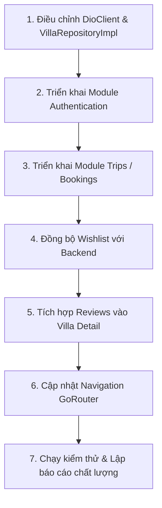

# KẾ HOẠCH NÂNG CẤP VÀ MIGRATION FLUTTER (MIGRATION_PLAN)

**Mục tiêu:** Đưa ứng dụng Flutter `hotel-booking-flutter` đạt đầy đủ chức năng tương đương Frontend gốc, tích hợp liền mạch với Backend Express.js và tuân thủ các quy định bảo mật di động.

---

## 1. PHÂN LOẠI CÔNG VIỆC

### Nhóm A — Đã hoàn thành (Giữ nguyên & bảo vệ)
- Thiết kế hệ thống tokens (`AppColors`, `AppTypography`, `AppSpacing`, `AppRadii`, `AppTheme`).
- Các widget nền tảng: `PropertyCard`, `PropertyImageCarousel`, `PropertySpecsRow`, `VillaBadge`, `AppButton`, `AppTextField`.
- Tích hợp tư vấn nhanh Hotline và Zalo OA qua `ContactService`.
- Bộ lọc ngày chọn lịch `BookingDate` độc lập múi giờ thiết bị, hỗ trợ chuẩn `YYYY-MM-DD`.

### Nhóm B — Đã triển khai một phần (Cần hoàn thiện ngay)
- `VillaRepositoryImpl`: Chuyển đổi endpoint từ `/v1/villas` sang chuẩn Backend `/api/listings`, `/api/listings/:id`, `/api/listings/:id/availability`. Ánh xạ đúng envelope `{ success: true, data: { items: [...] } }`.
- `SearchScreen`: Kết nối các trường tìm kiếm (ngày check-in, check-out, số khách, keyword) vào query parameters của `/api/listings`.
- `FavoritesScreen`: Bổ sung kết nối API `/api/wishlist` khi người dùng đã đăng nhập (fallback an toàn vào local preferences khi là khách vãng lai).

### Nhóm C — Chưa có trong Flutter (Cần xây dựng mới theo chuẩn Clean Architecture)
- **Module Authentication (`features/auth/`):**
  - Data: `AuthRepositoryImpl` gọi `POST /api/auth/login`, `POST /api/auth/register`, `POST /api/auth/forgot-password`, `GET /api/auth/me`, `POST /api/auth/logout`.
  - Presentation: `LoginScreen`, `RegisterScreen`, `ForgotPasswordScreen`.
  - State: `authNotifierProvider` lưu trữ trạng thái đăng nhập và tự động đồng bộ token vào `SecureStorageService`.
- **Module Chuyến đi / Đặt phòng (`features/trips/`):**
  - Data: `BookingRepositoryImpl` gọi `GET /api/bookings/mine`, `GET /api/bookings/:id`, `POST /api/bookings/:id/cancel`.
  - Presentation: `TripsScreen` với giao diện 3 trạng thái tab: Sắp tới (Upcoming), Đã hoàn thành (Completed), Đã hủy (Cancelled).
- **Module Đánh giá (`features/reviews/`):**
  - Data & Presentation: Tích hợp API `GET /api/listings/:id/reviews` hiển thị nhận xét thực tế từ khách lưu trú trên màn hình chi tiết villa.

### Nhóm D — Tối ưu trải nghiệm Mobile
- Bố cục responsive, hỗ trợ Safe Area, chống tràn bàn phím (avoid keyboard overflow bằng `SingleChildScrollView` + `viewInsets.bottom`).
- Trạng thái loading mượt mà bằng Shimmer/Skeleton thay vì spinner toàn màn hình thô kệch.
- Tự động đính kèm Header `Authorization: Bearer <token>` thông qua Interceptor của `DioClient`.

### Nhóm E — Phạm vi đặc thù hệ thống
- Module Quản trị Admin và Chủ nhà lớn (Host Portal) giữ nguyên trên giao diện Web vì chứa các bảng biểu phân tích tài chính phức tạp, xuất Excel, đồ thị lớn dành cho desktop.

---

## 2. THỨ TỰ THỰC HIỆN ƯU TIÊN

1. **Bước 1:** Chuẩn hóa `DioClient` (hỗ trợ Auth Token Interceptor & cho phép HTTP dev URL) và cập nhật `VillaRepositoryImpl` theo đúng cấu trúc `/api/listings`.
2. **Bước 2:** Xây dựng `features/auth/` (Domain, Data, Presentation, Riverpod Provider).
3. **Bước 3:** Xây dựng `features/trips/` (Domain `Booking`, Data `BookingRepositoryImpl`, Presentation `TripsScreen`).
4. **Bước 4:** Nâng cấp `features/favorites/` kết nối `/api/wishlist`.
5. **Bước 5:** Thêm phần hiển thị đánh giá `reviews` trong `features/villa_detail/`.
6. **Bước 6:** Mở rộng [app_router.dart](file:///D:/MANAGER-PROJECT/hotel-booking-flutter/lib/app/router/app_router.dart) hỗ trợ đầy đủ các routes mới.
7. **Bước 7:** Viết và chạy unit tests xác thực toàn bộ nghiệp vụ.
